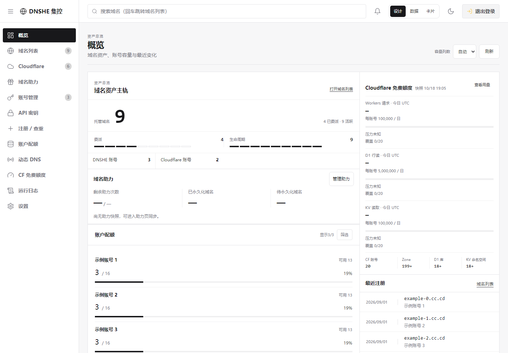
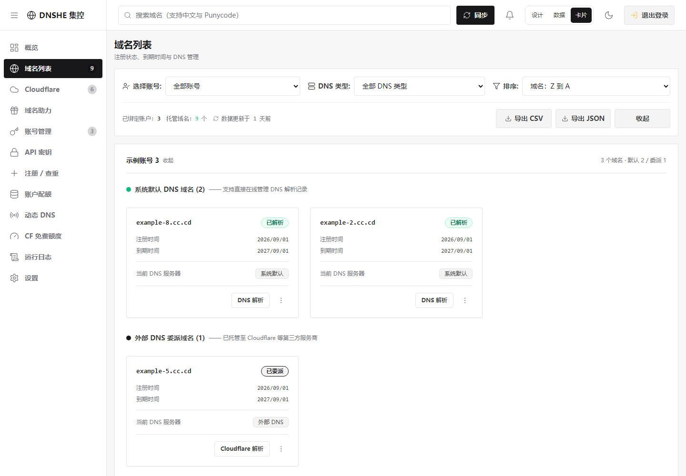
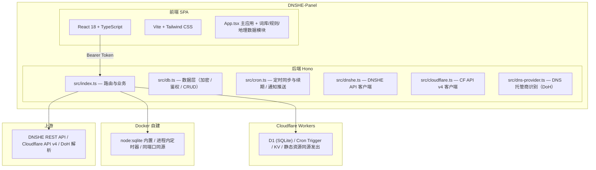

# 🌐 DNSHE-Panel

> DNSHE 多账号域名集控面板 —— 面向多账号、批量域名和 Cloudflare 资源管理的集中式工作台。

[](https://github.com/shiranzby/DNSHE-Panel/actions/workflows/docker.yml)
[](LICENSE)

DNSHE-Panel 基于 [lioil522/dnshe-manager](https://github.com/lioil522/dnshe-manager) 二次开发。上游已经提供了域名资产看板、Cloudflare 管理、定时同步与续期、通知推送和自建版 Node 适配；本仓库在它之上补齐了概览页指标卡与账户配额、域名注册查重、运行日志、API 密钥集中管理、域名助力与助力记录、**一键委派到 Cloudflare**，并修掉了一批请求竞态与健壮性问题。同一套后端代码同时支持 **Cloudflare Workers** 与 **Docker 自建** 两种部署形态。

**当前版本：设计、数据、卡片三种平级画风。** 可按页面保存偏好，共享顶栏搜索与业务状态；同时完善资产检查器、注册查重、API 密钥工作面、Cloudflare 逐项读取诊断，并新增独立的自动续期工作页。注册成功后的列表同步和续期结果都保留明确的最终一致性与失败语义，不把旧缓存或未知日期伪装成新成功。

先体验真实前端：[GitHub Pages 三画风演示](https://shiranzby.github.io/DNSHE-Panel/)。Pages 直接构建 `frontend/src`，只把 API 请求替换为合成响应，不连接任何 Worker、数据库、Cookie 或 API Token；源码和自建部署说明仍在本仓库中。

## 🧭 文档导航

- [功能特性](#功能特性)：三种画风、资产、Cloudflare、查重与运行日志
- [架构概览](#架构概览)：前端、Worker、Docker 与上游服务的边界
- [部署方式](#部署方式)：Cloudflare Workers、Wrangler 与 Docker
- [环境变量](#环境变量)：自建版可选配置与密钥备份要求
- [本地开发](#本地开发)：构建、隔离预览与定向回归
- [常见问题](#常见问题)：助力缓存、升级回滚、API v1/v2 兼容及读取失败排查

---

## 📸 界面参考

以下截图是合成数据参考图，不含真实账号、凭据或用户域名；完整真实前端交互请直接打开上面的 Pages 演示。

设计风概览：



卡片风域名列表：



> 仓库中的截图均为合成数据，用于说明结构和交互，不代表任何部署实例或真实账号。

---

## ✨ 功能特性

### 三种画风，按页选择

| 画风 | 阅读方式 |
| --- | --- |
| 设计风（默认） | 对象目录、主辅轨道、额度与趋势，详情按需进入右侧检查器 |
| 数据风 | 表格、共同列线、紧凑指标，适合搜索、比较与多账号巡检 |
| 卡片风 | 自适应多列对象卡，保留账号分组与完整操作入口 |

- 概览、域名列表、Cloudflare、域名助力、账号管理、API 密钥、账户配额、动态 DNS 与自动续期支持三种模式；CF 免费额度支持设计／数据。查重、日志与设置使用共享工作面，不显示无效的顶栏切换。
- **设置 → 界面画风**提供全局默认与逐页覆盖；顶部只显示当前页支持的模式。可将某页恢复为「跟随全局」。
- 偏好保存于当前浏览器，刷新恢复；明暗主题独立。升级保留旧卡片偏好，不清空原列数、折叠状态或业务数据。
- 切换共用同一批对象、账号范围、搜索、排序与未保存输入，不为不同画风复制业务状态。
- 顶栏搜索随页面切换并分别记忆关键词，不再重复摆放页内搜索框。模态支持 **Esc** 关闭、焦点归还；资产与密钥检查器平滑滑入／退出。

### 资产管理

- **多账号管理** — 绑定多个 DNSHE API Key，跨账号统一管理；支持单条与批量粘贴（逐行 `Key Secret`、逗号/空格/Tab 分隔，亦兼容 JSON 数组）
- **域名列表** — 按账号分组折叠，支持账号筛选与「系统默认 / 外部 DNS」类型筛选；每张卡直接显示注册/到期时间、当前 DNS 服务商、认证状态；账号徽章给出「共 N 个域名（系统默认: x | 外部DNS: y）」的分布
- **概览看板** — 域名资产、账号与助力、账户配额、CF 免费额度与最近注册按画风重组；设计风采用主辅轨道，避免短卡被强行拉高填空
- **账户配额** — 顶部汇总全部账号，下面保留每个子账号的基础额度、邀请加成、已用与可用配额；支持筛选和按需隐藏账号

### 解析与 Cloudflare

- **DNS 解析管理** — 面板内增删改 DNS 记录（A / AAAA / CNAME / MX / TXT 等），支持批量添加与批量修改
- **解析线路** — 识别支持按线路解析的根域，行内选择线路
- **Cloudflare 管理** — 独立标签页绑定 Cloudflare 账号（绑定即在线校验 Token、别名自动取账号名），自动同步 zones；zone 卡支持全部记录类型的增删改与批量操作、橙色云代理开关、控制台深链
- **跨站交叉提示** — DNSHE 域名若 NS 已指向 Cloudflare 且已绑定账号，一键跳转定位到对应的 zone 解析面板
- **一键委派到 Cloudflare** — 面板内直接为该域名创建 Cloudflare zone，并把 Cloudflare 分配的两条 NS 写回 DNSHE 完成委派；**先完成委派，再把待迁移的解析记录列出来让你逐条勾选确认**，不会自动搬运解析。仅对已列入 Public Suffix List 的根域开放（`us.ci` / `cc.cd` / `de5.net` / `ccwu.cc`），其余根域的菜单项置灰并当场写明原因
- **CF 免费额度** — Workers 请求、D1 读写与存储摘要；七日请求可悬停、聚焦、点按或用方向键逐日查看。全部账号范围显示合计及最高单账号使用率，**不把独立额度伪装成共享额度池**；支持搜索、状态筛选、排序及按需分页，手机使用可展开摘要卡。
- **逐项读取诊断** — 区分权限、认证、限流、超时、网络、服务未启用与查询失败。整行可展开对应账号详情，沿主页面滚动，不另造一层纵向滚动条；Pages、R2、KV 提供对应管理入口。旧缓存、今日没有操作记录、未返回日期与真实零分别表达，不冒充本次成功。

### 注册与助力

- **精准单域名查重** — 单域名 WHOIS 查重与注册，支持多账号范围，并展示查询结果与历史
- **规则多域名查重** — 词库标签（`{字母}` / `{地名城市}` / `{网站App}` …）、自定义前缀与正则过滤自由组合；字母、数字及混合短字符统一进入规则，不另开自动扫描任务。支持顺序检测、暂停／继续／停止与断点续查；单轮最多 20,000 个候选，保留续查游标
- **查重范围与缓存** — 账号默认全选，展开后复选；主动空选会阻止开始。当前浏览器保存最近 20,000 个域名的真实结果与查询时间，默认复用 24 小时内已确认结果及查重池中 7 天内已注册记录，也可强制重查。失败保留前次已确认结果，不把失败当成可注册或官方预留
- **自定义排除** — 排除字符、正则及前缀名单只控制哪些候选参与查询，**不代表官方禁止注册**；预留／禁止结论必须来自上游明确响应
- **域名助力** — 生成/使用助力码把域名升级为永久；助力前弹出确认窗列出将使用的账号与消耗次数，可取消勾选（自己的号给自己的域名助力必然失败）；助力明细与最近助力记录（按助力码聚合、每页 10 条）

### 自动化与安全

- **自动续期** — 独立工作页查看续期窗口、到期日期、最近任务与失败语义；定时任务只把可解析且已进入阈值（含已过期）的域名交给上游，缺少到期日期保持未知，成功响应缺少新日期时保留本地旧值。Cloudflare Workers 默认每天 UTC 03:00（北京时间 11:00）运行一轮；Docker 自建版按自身 node 定时器配置运行
- **配额感知的同步** — 单次调用受 Workers 免费版「50 个子请求」限制，同步按**域名**预算分批并把剩余部分交回前端续跑，不静默丢账号
- **通知推送** — 钉钉 / 飞书 / 企业微信 / Server酱 / Telegram / 自定义 Webhook / **邮箱 SMTP**
- **安全认证** — 用户名 + 密码（PBKDF2 加盐哈希），可选 2FA (TOTP)；AES-GCM 加密存储 API Secret、API 密钥 Secret 与 2FA 密钥
- **API 密钥页** — DNSHE 官方 API 密钥（Key／Secret）集中管理，支持创建、查看、复制、重置与删除；Secret 加密保存、按需解密。首屏先读本地库快照，实时状态再逐账号补齐；超时或读取失败保留旧快照，缓存不冒充实时结果
- **动态 DNS** — 管理更新配置、最近 IP 与结果，提供设计／数据／卡片视图；未绑定时展示明确标注的模拟样本，可随时关闭，不写入真实配置
- **运行日志** — 分类与结果筛选、分页和手动刷新；结果使用 `success / error / warning / info`，保留少量语义色。审查脚本可复用有效会话，减少重复登录产生的审计记录，不删除真实登录日志
- **主题与国际化域名** — 深色/浅色主题、刷新无闪白；Punycode 域名的中英互转与显示

### 工程化

- **增量复核 + 子请求预算** — 上游 `updated_at` 没变过的域名不再重复查解析记录（稳态每账号只花 1 次子请求），配合按域名分档的预算，手动同步与定时任务都不会撞上 Workers 免费版「单次调用 50 个子请求」的上限（详见 [Worker 子请求上限的处理](#-worker-子请求上限的处理)）
- **失败不再静默** — 同步失败会写进运行日志，不再出现「账号凭空消失但日志空白」

---

## 🏗️ 架构概览



前端与后端在**同一个 Worker** 里：静态资源由 Cloudflare 直接发出（不进 Worker、不计 Worker 请求数），只有 `/api/*` 才执行脚本。因此没有 Pages 项目、没有第二个域名，也不需要配 CORS。

---

## 🚀 部署方式

### 方式一：Cloudflare Workers — GitHub Actions 一键部署（推荐）

Fork 仓库后配置 Secrets，推送到 `main` 即自动部署。

> **ℹ️ 本仓库的 `deploy.yml` 默认处于停用状态**（作者不在 GitHub 上保存 Cloudflare 凭据）。
> 需要云端自动部署时，到 `Actions` → `Deploy to Cloudflare` → `Enable workflow` 打开即可，
> 或直接在本地跑 `npx wrangler deploy`（见方式二的自建版说明，Workers 同样适用）。

#### 1. 获取 Cloudflare 凭据

登录 [Cloudflare Dashboard](https://dash.cloudflare.com/)：

- **Account ID**：任意域名的「概述」页右侧栏
- **API Token**：「我的个人资料」→「API 令牌」→「创建令牌」，需要以下权限：

| 权限 | 说明 |
|------|------|
| `Workers Scripts:编辑` | 部署 Worker（后端脚本 + 前端静态资源） |
| `D1:编辑` | 自动创建 / 绑定 D1 数据库 |
| `Workers KV Storage:编辑` | 自动创建 / 绑定 KV 命名空间（域名助力缓存） |
| `Workers Routes:编辑` | 自动检测自定义域名 |
| `Zone:读取` | 查询域名路由 |

#### 2. 配置 GitHub Secrets

`Settings` → `Secrets and variables` → `Actions` → `New repository secret`：

| Secret 名称 | 是否必填 | 说明 |
|-------------|---------|------|
| `CLOUDFLARE_API_TOKEN` | ✅ 必填 | 上一步创建的 API Token |
| `CLOUDFLARE_ACCOUNT_ID` | ✅ 必填 | Cloudflare 账户 ID |
| `CLOUDFLARE_D1_DATABASE_ID` | 可选 | D1 数据库 ID，留空按 `wrangler.toml` 里的 `database_name` 查找，找不到就新建 |
| `CLOUDFLARE_KV_NAMESPACE_ID` | 可选 | KV 命名空间 ID，留空沿用 `wrangler.toml` 里那个（属于本账号时）或新建 |
| `AES_KEY` | 可选 | 加密密钥，留空首次部署自动生成 |
| `ADMIN_TOKEN` | 可选 | 应急后门令牌 |
| `WEBHOOK_URL` | 可选 | 通知推送地址 |
| `ALLOWED_ORIGIN` | 可选 | CORS 白名单。前后端同源，正常部署**不需要** |

#### 3. 触发部署

- 推送到 `main`（自动触发），或
- `Actions` → `Deploy to Cloudflare` → `Run workflow`

工作流会自动完成：绑定 D1 / KV（按需创建并写回 `wrangler.toml`）→ 检测自定义域并关闭 workers.dev → 构建前端 → 一次 `wrangler deploy` 同时上传后端与静态资源 → 生成/同步 `AES_KEY` → 同步可选 Secrets。

> **💡 首次部署后**，访问地址在该次运行的**摘要页**顶部。打开它，在登录页自行设置管理员用户名与密码。
>
> ⚠️ 启用后，`deploy.yml` 里 **`main` 分支的 push 会自动部署**。如果只是提交代码、不想发版，请给 commit message 加 `[skip ci]`。

### 方式二：Cloudflare Workers — 本地 wrangler 手动部署

不想把 Cloudflare 令牌交给 GitHub Actions 时用这条：

```bash
git clone https://github.com/shiranzby/DNSHE-Panel.git
cd DNSHE-Panel

npm install
npm --prefix frontend install

# 🔴 关键：必须带 VITE_API_BASE_URL，缺了线上登录会直接报「未配置后端地址」
#    （frontend/vite.config.ts 现在会在缺变量时让构建失败，避免静默上线；
#      MSYS_NO_PATHCONV=1 也不能省 —— Git Bash 会把裸斜杠 / 改写成 Git 安装根目录）
cd frontend
MSYS_NO_PATHCONV=1 VITE_API_BASE_URL=/ npx vite build
cd ..

# 先在 wrangler.toml 里改 name 与 [[d1_databases]] / [[kv_namespaces]] 的 id
export CLOUDFLARE_EMAIL="你的 Cloudflare 邮箱"
export CLOUDFLARE_API_KEY="你的 Global API Key"
export CLOUDFLARE_ACCOUNT_ID="你的 Account ID"
npx wrangler deploy

# 注入加密密钥（只需一次；换密钥会让库里已加密的 Secret 全部解不开）
openssl rand -hex 32 | npx wrangler secret put AES_KEY
```

自定义域用 `PUT /accounts/{account_id}/workers/domains` 挂载（Cloudflare 会自动建 `AAAA → 100::` 记录并签发证书），比手工配 A 记录 + Workers 路由少两步。

### 方式三：Docker 自建

```bash
curl -O https://raw.githubusercontent.com/shiranzby/DNSHE-Panel/main/docker-compose.yml
# 可选：需要固定版本、改镜像站或配置密钥时下载 .env.example；已有 .env 不覆盖
curl -O https://raw.githubusercontent.com/shiranzby/DNSHE-Panel/main/.env.example
if [ ! -f .env ]; then cp .env.example .env; fi
docker compose up -d
# 浏览器打开 http://<服务器IP>:8787，首次进入自行设置管理员用户名与密码
```

更新：`docker compose pull && docker compose up -d`

> **⚠️ 大陆网络提示：** `ghcr.io` 拉取可能很慢，可在 `.env` 中设置镜像站：
> `IMAGE_REPO=ghcr.nju.edu.cn/shiranzby/dnshe-panel`
> 生产环境建议固定版本而不是 `latest`：
>
> ```dotenv
> IMAGE_REPO=ghcr.nju.edu.cn/shiranzby/dnshe-panel
> IMAGE_TAG=2026.10.18
> ```

镜像为 `amd64` / `arm64` 多架构；运行时镜像不含 `node_modules`（后端由 esbuild 打包成单文件）；以 uid 1000 非 root 运行；内置 HEALTHCHECK。

---

## ⚙️ 环境变量

所有变量均为**可选**，全部留空也能正常启动。

| 变量 | 说明 | 默认值 |
|------|------|--------|
| `AES_KEY` | AES-GCM 加密密钥，用于加密 API Secret、API 密钥 Secret 与 2FA 密钥 | 自动生成并保存到 `/data/aes.key` |
| `ADMIN_TOKEN` | 应急后门令牌，忘记密码时的兜底登录方式（也接受其对应的 TOTP 动态码） | 不启用 |
| `WEBHOOK_URL` | 通知推送地址 | — |
| `WEBHOOK_TYPE` | 推送类型：`dingtalk` / `feishu` / `wecom` / `serverchan` / `custom` / `email` | — |
| `ALLOWED_ORIGIN` | CORS 允许来源（逗号分隔）。自建版前后端同源，无需配置 | — |
| `DEFAULT_API_KEY` | 首次启动自动绑定的 DNSHE API Key | — |
| `DEFAULT_API_SECRET` | 首次启动自动绑定的 DNSHE API Secret | — |
| `DEFAULT_API_ALIAS` | 默认账号别名 | — |
| `IMAGE_TAG` / `IMAGE_REPO` | 自建镜像版本与地址 | `latest` / `ghcr.io/shiranzby/dnshe-panel` |
| `CRON_UTC_HOUR` / `CRON_UTC_MINUTE` | 自建版定时任务执行时刻（UTC） | `2` / `0`（北京时间 10:00） |
| `DISABLE_CRON` | 设为 `1` 关闭每日自动同步与续期 | — |
| `TZ` | 容器内日志时区 | `Asia/Shanghai` |

> **⚠️ 备份提醒：** `AES_KEY` 必须与数据库一起备份。密钥丢失后，库中加密的 API Secret 与 2FA 密钥将无法解密。
>
> **SMTP 说明：** 邮箱通知的 SMTP 账号在**面板设置页**里配置（不是环境变量）。Workers 运行时通过 `cloudflare:sockets` 的 `connect({ secureTransport: "on" })` 走隐式 TLS 直连 465 端口，实测 QQ 邮箱可正常发信。

---

## 📁 项目结构

```
DNSHE-Panel/
├── src/                        # 共享业务代码（Workers 与自建版共用）
│   ├── index.ts                #   Hono 路由与 API 处理（含鉴权中间件）
│   ├── db.ts                   #   数据库管理器（加密、鉴权、CRUD、缓存）
│   ├── cron.ts                 #   定时同步与续期、Webhook/SMTP/Telegram 推送
│   ├── dnshe.ts                #   DNSHE API 客户端
│   ├── cloudflare.ts           #   Cloudflare API v4 客户端（zone 与解析记录）
│   ├── cfusage.ts              #   CF 用量采集、逐项诊断与快照合并
│   ├── dns-provider.ts         #   DNS 托管商识别（DoH）+ 增量复核计划（planDnsChecks）与有界并发
│   └── punycode.ts             #   国际化域名编码
│
├── server/                     # 自建版专属（Node 运行时适配）
│   ├── index.ts                #   Node 入口（env 组装、定时器、AES 密钥自举）
│   ├── d1-sqlite.ts            #   D1 → SQLite 适配层（node:sqlite）
│   ├── d1-sqlite.test.ts       #   适配层自检（22 项，含增量同步的时间戳语义）
│   └── static.ts               #   静态资源服务（SPA 兜底、ETag、缓存头）
│
├── frontend/                   # 前端（React + TypeScript + Vite）
│   ├── src/
│   │   ├── App.tsx             #   主应用（13 个工作页）
│   │   ├── RenewalPage.tsx     #   自动续期工作页（三种画风）
│   │   ├── InterfaceStyle.tsx  #   三画风、全局默认与逐页偏好
│   │   ├── PageSearch.tsx      #   顶栏搜索与各页独立关键词
│   │   ├── EditorialViews.tsx / FlowWorkspaces.tsx
│   │   ├── AssetCollection.tsx / QuotaCollection.tsx
│   │   ├── CfQuotaPage.tsx / CfQuotaModel.ts / CfCharts.tsx
│   │   ├── rulegen.ts          #   查重规则解析与候选生成
│   │   ├── wordbanks.ts        #   可编辑词库
│   │   ├── dnsrecords.ts       #   DNS 记录类型定义
│   │   ├── geodata.ts / zipcodes.ts / pinyin.ts / enwords.ts
│   │   └── punycode.ts         #   前端侧 Punycode
│   ├── public/_headers         #   静态资源安全响应头
│   └── vite.config.ts
│
├── .github/workflows/
│   ├── docker.yml              #   自建镜像构建与发布（amd64 + arm64）
│   └── deploy.yml              #   Cloudflare Workers 部署（后端 + 前端静态资源）
│
├── schema.sql                  # 数据库表结构
├── Dockerfile                  # 三阶段构建（前端 → 后端 → 运行时）
├── docker-compose.yml
├── wrangler.toml               # Cloudflare Workers 配置（含 [assets] 静态资源托管）
├── .env.example
└── package.json
```

---

## 🛠️ 本地开发

### 前置要求

- **Node.js** ≥ 22.5（自建版用内置 `node:sqlite`；自检脚本出现 `ExperimentalWarning` 属正常）
- **npm**
- **Wrangler** ≥ 4（已在 devDependencies）

### Cloudflare Workers 模式

```bash
npm install
npm --prefix frontend install

# ⚠️ 先构建一次前端：wrangler.toml 的 assets.directory 指向 frontend/dist，
#    该目录不存在时 wrangler dev / deploy 会直接报错退出。
#    用 build:selfhost（读 .env.selfhost，已知同源基准地址）；直接跑 build 会因为
#    缺 VITE_API_BASE_URL 而被 vite.config.ts 拦下 —— 这是故意的，见「改了前端代码」。
npm --prefix frontend run build:selfhost

# 启动后端（默认 8787，同时把 frontend/dist 当静态资源发出）
npm run dev

# 改前端时另起 Vite 开发服务器（自动代理 /api 到 8787）
npm --prefix frontend run dev
```

### 本地隔离预览（完整 Node 实例）

需要实际点击查看，而不只是看截图时，可在独立端口运行前后端。以下示例使用新的本地数据库，不读取或改写已有日用数据库。请在新的 PowerShell 终端进入仓库根目录后运行：

```powershell
npm ci
npm --prefix frontend ci
npm --prefix frontend run build:selfhost
npm run build:node

$env:HOST='127.0.0.1'
$env:PORT='3014'
$env:DISABLE_CRON='1'
$env:DATA_DIR='./data/local-preview'
$env:DB_PATH='./data/local-preview/dnshe.db'
$env:STATIC_DIR='./frontend/dist'
npm run start:node
```

打开 **http://127.0.0.1:3014**，首次设置本地管理员；保持终端运行，按 `Ctrl+C` 停止。该示例不会自动导入线上账号、登录态或数据，也不会运行定时同步与续期。不要复用日用服务的环境变量或数据目录。

**隔离数据库不等于隔离远端操作。** 绑定真实 API Token 后，手动改 DNS、委派、续期等仍会影响对应远端服务。只查看画风无需绑定真实账号；仓库中的离线交互测试会自动提供合成数据。

### 自建模式（已有环境）

```bash
npm run build:node       # esbuild 打包为单文件
npm run start:node
```

### 定向回归

模型、服务端采集与 Node 适配测试无需登录：

```bash
npm run test:quota
npm run test:usage:backend
npm run test:cf:permissions
npm run test:delegate:cf
npm run test:renewal:rules
npm run test:domain-check:cache
npm run test:node
npm run verify:node
```

浏览器测试使用根目录锁定的 Playwright 1.59.1。完成 `npm ci` 后，首次安装其 Chromium：

```bash
npx playwright install chromium
```

在另一个终端启动本地前端（该端口仅供前端与合成数据回归，不是完整日用实例）：

```bash
npm --prefix frontend run dev -- --mode selfhost --host 127.0.0.1 --port 3012 --strictPort
```

然后在仓库根目录执行：

```bash
npm run test:style:ui
npm run test:asset:layout
npm run test:quota:ui
npm run test:apikey:ui
npm run test:apikey:surface
npm run test:overview:layout
npm run test:register-ddns:ui
npm run test:flows:ui
```

补充用量边界案例（PowerShell）：

```powershell
$env:CF_UI_CASE='boundaries'
npm run test:quota:ui
Remove-Item Env:CF_UI_CASE
```

这些 UI 测试默认使用本地合成数据，拦截 API，不登录、不发起生产业务写入，以 headless 模式运行。可用 `BASE` 指向另一个本地前端端口；`REVIEW_PLAYWRIGHT` 仅用于需要自定义运行时的环境。真实账号的只读审查是另一条流程，不能用离线绿灯代替实网验收。

---

## 📝 数据库结构

| 表名 | 用途 |
|------|------|
| `accounts` | 账号（provider、别名、API Key / Cloudflare Token、加密后的 Secret） |
| `domains_cache` | 域名缓存（状态、到期时间、NS、解析记录三态、续期记录、`remote_updated_at` 增量复核时间戳） |
| `logs` | 系统运行日志（同步 / 续期 / 鉴权 / 系统分类） |
| `cache` | 上游响应缓存（配额、查重池等，带过期时间） |
| `settings` | 面板设置（含 SMTP 配置、通知渠道等，键值对） |

D1 与自建版用的都是 SQLite，表结构完全一致，可直接迁移（**`AES_KEY` 必须保持一致**）。

---

## 🚦 Worker 子请求上限的处理

Cloudflare Workers 免费版对**单次调用**有 50 个子请求的硬上限，`fetch` 以及 KV / D1 等绑定调用都计入。上游的实现是「一次性遍历所有账号 + 每个域名单独查一次 DNS 记录」，账号一多必然超限；超限抛出的 `Too many subrequests by single Worker invocation` 又会被账号级 `try/catch` 吞掉，循环里后面的账号直接跳过 —— 现象就是**部分账号的域名凭空消失，日志里却看不出原因**（上游 [issue #8](https://github.com/lioil522/dnshe-manager/issues/8)）。

本仓库用四层约束把单次调用的子请求数压回上限以内：

| 路径 | 约束方式 | 单次开销 |
|------|----------|----------|
| **增量复核**（所有同步路径共用） | 上游 `subdomains/list` **免费**带回每个域名的 `updated_at`，而三态完全由该域名区域内的解析记录推导 ⇒「上游 `updated_at` 与上次复核时一致」等价于「三态没变」，那一次 `dns_records/list` 直接省掉。判据（`planDnsChecks`）：新域名 → 时间戳变了 → 缓存里的状态不是三态 → 本地行超过 7 天没被写过（兜底） | **稳态每个账号 1 次**（只有列表页），冷启动或域名改动后才按域名付费 |
| 手动全量同步 `POST /api/domains/sync` | **按域名预算分批**：`SYNC_SUBREQUEST_BUDGET = 34` 是「本次调用允许消耗的网络子请求数」，同步与续期共享同一份预算；被截断的域名回 `pending`、账号回 `remaining`，前端按 `done` 接力直到清空 | ≤ 34 |
| 定时任务（Workers Cron / 自建版 node-cron） | 同一份预算，从持久化游标 `sync_cursor` 起**顺序尽量多扫**（不再是每轮只扫一个账号）；预算见底就把剩下的账号留给下一轮，游标正好停在断点 | ≤ 34 |
| 解析线路的 NS 查询 `POST /api/dnshe/ns-lookup` | **限额 + 缓存**：单次最多查 20 个根域名（`NS_MAX_ROOTS = 20`，每个最坏 2 次子请求），结论缓存 30 天 | ≤ 40 |
| **密钥页首屏** `GET /api/keys?source=local` | **先读本地库快照**：每次全量刷新都把上游密钥清单登记进 `api_keys` 表（登记时不带 Secret，不会覆盖已保存的密文）⇒ 打开页面直接读库出结果，一个上游请求都不发；实时状态（请求次数/最后使用）由前端在后台逐账号补齐 | **0 次上游请求**（只有 D1 查询） |

线上实测（6 个 DNSHE 账号 + 1 个 Cloudflare 账号，共 50 个域名 / 29 个 zone）：

| 场景 | 轮次 | 子请求 | 复核域名 | 用时 |
|------|------|--------|----------|------|
| 冷启动（`remote_updated_at` 全空） | 2 轮（34/34 → 24/34） | 58 | 50 | 28s |
| 稳态 | 1 轮 | **7**（每账号 1 次） | 0 | 5s |

> 以上为历史环境测量，不是当前实例的速度或规模承诺。日用库不应为测试清空同步时间戳；优先运行隔离数据库与合成数据回归。

**单账号域名超限**（原先的已知边界）已解决：预算落在**域名**这一层，不再是账号层。所以哪怕某个账号有几百个域名，一次调用也只复核预算内的那部分，剩下的走 `pending` / `remaining` 交给前端或下一轮 cron 继续 —— 不会再出现「后面的账号被静默跳过」。代价是极端情况下需要多次调用才能覆盖完全部域名，进度以前端按钮上的「同步中 x/y」呈现。

定时任务同样不再受账号数限制：稳态下每个账号只要 1 次子请求，所以每日一轮会从持久化游标继续尽量覆盖全部账号（早先是「每轮一个账号」，6 个账号要 6 轮才轮到一圈）。预算用尽时保留游标，下一轮继续，不静默丢弃后续账号。

---

## ❓ 常见问题

### Docker 提示「未绑定 ASSIST_KV」怎么办？

这是旧版 Docker 镜像在没有 Cloudflare KV binding 时的提示。当前 Docker 自建版不需要额外创建 Cloudflare KV：启动时会自动注入 SQLite-backed `ASSIST_KV`，助力码和相关快照写入挂载的 `/data`，重启后仍可恢复；只有 Cloudflare Workers 部署才使用 `wrangler.toml` 中配置的 `ASSIST_KV` namespace。

升级前已经看到过该提示时：

1. 拉取当前镜像并重启容器：`docker compose pull && docker compose up -d`；
2. 确认 `docker-compose.yml` 将宿主机目录挂载到 `/data`，且该目录对容器 uid 1000 可写；
3. 查看容器日志，并只读检查 `/api/auth/status` 与 `/api/assist/status`；
4. 在源码目录运行 `npm run test:local-kv`，确认本地适配层回归通过。

如果 `/data` 不可写，缓存无法持久化，重启后会重新出现空状态；不要为 Docker 自建版盲目创建 Cloudflare KV，也不要把「无当日记录」误判成 KV 未绑定。

### Docker 如何升级、备份与回滚？

升级前先备份数据卷，尤其是数据库和 `AES_KEY`。默认 `docker-compose.yml` 使用命名卷 `dnshe-data`，可这样导出到当前目录：

```bash
docker compose down
docker run --rm -v dnshe-data:/data -v "$PWD:/backup" alpine \
  tar czf /backup/dnshe-data-$(date +%Y%m%d-%H%M%S).tgz -C /data .
docker compose pull
docker compose up -d
docker compose logs --tail=100 dnshe-panel
```

如果你把 compose 改成了 `./data:/data` 的宿主机目录挂载，再备份 `./data` 即可；无论哪种方式，都要确保 `/data` 对容器 uid 1000 可写。

升级不会清空 `/data`，也不会自动轮换 `AES_KEY`。如果新版本异常，先保留故障日志，再把 `.env` 的 `IMAGE_TAG` 改回上一版本并重新启动；不要删除数据目录，也不要生成新 AES 密钥覆盖旧值。回滚后同样用 `/api/auth/status` 和 `/api/assist/status` 做只读健康检查。

### DNSHE API v1 / v2 如何兼容？

面板优先调用 DNSHE 官方 V2 命名；仅当上游明确返回 `404`、`not found` 或“不支持”时，才回退到仍可用的旧命名。权限不足、限流、参数错误和网络超时不会触发旧接口重试，避免重复写入或掩盖真实错误。

| 能力 | V2 首选 | 旧版回退 | 备注 |
|---|---|---|---|
| 子域名列表 | `subdomains/list` | — | 使用 `per_page ≤ 500`、稳定排序和 `include_total` |
| 注册子域名 | `subdomains/create`，参数 `domain` | `subdomains/register`，参数 `rootdomain` | 只在端点不存在时回退 |
| 助力状态 | `gifts/list` | `permanent_upgrade/list` | 读操作 |
| 生成助力码 | `gifts/initiate` | `permanent_upgrade/create` | 写操作，仅 404 回退 |
| 取消助力码 | `gifts/cancel` | `permanent_upgrade/cancel` | 只允许当前账号的 pending 记录 |
| 使用助力码 | `gifts/accept`，参数 `code` | `permanent_upgrade/assist`，参数 `assist_code` | 每个账号串行调用 |
| DDNS 更新 | `ddns/update` | — | 使用记录专用 Bearer Token，不把令牌放进 URL 或日志 |

DNSHE 主 API 使用 `X-API-Key` 与 `X-API-Secret`；DDNS 使用记录级 Bearer Token。若 V1/V2 返回字段不完整，面板会保留旧快照并在运行日志中标明失败，不把失败转换为空数据或成功。

### Docker 自建版有生产环境鉴权吗？

有。自建版与 Workers 版共用同一套应用层鉴权：首次访问先设置管理员用户名和密码；登录成功后签发服务端 Session Token，除健康检查和登录初始化接口外，受保护的 `/api/*` 请求都必须携带 `Authorization: Bearer <session_token>`。

- 用户名 + 密码是主要登录因子，密码使用 PBKDF2 加盐哈希保存；
- 设置页可开启 TOTP（MFA/2FA）。开启后，登录必须同时通过密码和 6 位动态验证码；MFA 是登录鉴权的一部分，不是接口权限本身；
- Session Token 是登录后的会话凭据，退出时服务端会撤销当前会话；
- 当前产品是单管理员模型，没有细粒度角色／权限管理。登录成功代表管理员身份，不代表不同角色权限；
- `ADMIN_TOKEN` 只是忘记密码时的应急旁路凭据，配置后可直接建立会话或访问受保护 API，必须使用高强度随机值并妥善保管；不需要时不要配置。

如果还需要入口级防护，可在反向代理、VPN 或 Cloudflare Access 上叠加网络层访问控制；这与应用自己的用户名、密码、Session 和 MFA 是两层不同的鉴权。

Docker 默认通过 `http://<服务器IP>:8787` 提供服务，不自动签发 HTTPS 证书、接入 SSO 或限制来源 IP。公开暴露前应在反向代理层配置 HTTPS，并按需要增加 VPN／Cloudflare Access；不要把带有 Session Token 的登录流量长期裸奔在公网 HTTP 上。

### Cloudflare 版与自建版有什么区别？

| | Cloudflare Workers | Docker 自建 |
|---|---|---|
| 数据库 | D1 (SQLite) | Node 内置 `node:sqlite` |
| 定时任务 | Cron Trigger | 进程内定时器 |
| 前端发布 | 同一个 Worker 的静态资源 | 同端口同源发出 |
| CORS | 同源，无需配置 | 同源，无需配置 |
| 运维 | Cloudflare 托管 | 自行运维 |

### 同步域名时有的账号「凭空消失」？

不是消失，是撞上了 Workers 免费版**单次调用 50 个子请求**的上限 —— 每个域名要单独查一次解析记录，超限部分会被静默丢弃，而异常又被账号级 `try/catch` 吃掉。本项目现在有两道保险：① **增量复核** —— 上游 `updated_at` 没变过的域名根本不发那次请求（稳态每账号只花 1 次）；② **按域名预算分批** —— 截断的域名回 `pending`、账号回 `remaining`，前端自动接力直到 `done: true`。手工触发「同步所有账号」时等按钮从「同步中 x/y」恢复即可。

### 改了前端代码，构建成功但线上还是旧界面？

先对比线上 `index.html` 引用的资源文件名，再核对实际 JS／CSS 内容哈希与本地 `frontend/dist` 一致，不只看部署命令是否成功。另外**不要漏掉 `VITE_API_BASE_URL=/`**：漏了会让登录直接报「未配置后端地址」（`frontend/vite.config.ts` 会阻止缺变量的构建）。推荐直接使用 `npm --prefix frontend run build:selfhost`，避免 Git Bash 将裸斜杠改写成 Git 安装根目录。

### 大陆访问 Cloudflare 版很慢怎么办？

先看 `https://<你的域名>/cdn-cgi/trace` 里的 `colo=`：`HKG`/`NRT`/`KIX`/`SIN` 属正常；落到 `AMS`/`FRA` 等欧洲节点就是路由异常。免费套餐不使用中国大陆网络，**没有任何开关能改变这个路由**，只能换部署位置（见方式二 / 方式三）。注意 `colo` 反映的是**发起请求那台机器**落到哪个 PoP，开代理测出来的结果与大陆访客无关。

### 忘记管理员密码怎么办？

配置了 `ADMIN_TOKEN` 就用它（或其对应的 TOTP 动态码）兜底登录；未配置则需清掉库中的管理员数据重新初始化。

### 助力时提示「本账号域名，已跳过」？

DNSHE 不允许自己的号给自家域名助力。在确认弹窗里把那个账号取消勾选即可 —— 排除名单会随请求一起发给后端，后端按账号 id 真正把它从候选里去掉（不只是界面上不算数）。

### 自动续期会处理 Cloudflare 的域名吗？

不会。Cloudflare 账号仅同步 zones 列表（有效期由注册商管理），不参与自动续期与配额统计；创建 zone 请用「一键委派到 Cloudflare」，删除 zone 仍请前往 Cloudflare 控制台。

### 注册成功后为什么没有立刻出现在域名列表？

注册商的列表接口可能存在短暂的最终一致性窗口。面板在注册响应后做有限次数的列表读取；仍未出现时会返回“正在同步列表”的状态，并由 Worker 在后台再做一次有界重试。前端也会按完整域名短暂轮询本地缓存。这个状态不代表注册失败，也不会用旧列表伪造“已同步”；超过等待窗口后请稍后刷新或手动同步。

### 自动续期为什么没有执行？

先在“自动续期”工作页查看到期日期、阈值和最近运行日志。没有可解析到期日期的域名会保持“未知”，不会被猜测为可续期；尚未进入上游免费续期窗口、限流、权限或网络失败会写入对应日志并留给后续任务重试。若上游返回成功但缺少新的到期日期，面板会保留旧日期并记录不完整响应，避免把空值写入数据库。Workers 的默认任务时间是每天 UTC 03:00（北京时间 11:00）；Docker 自建版请以容器日志中的下一次任务时间为准。

### 绑定 Cloudflare 账号需要什么权限？

API Token 需含 `Zone:Read` 与 `Zone DNS:Edit`，作用范围建议覆盖要管理的域名。绑定时会调 `user/tokens/verify` 在线校验，无效或已禁用的 Token 不入库；同一 Cloudflare 账号不可重复绑定。

「一键委派到 Cloudflare」还要调用 `POST /zones` 创建 zone —— Cloudflare 官方文档标注该接口接受 `Zone:Edit` 或 `Zone DNS:Edit` 之一。若委派时报权限不足，给 Token 补上 `Zone:Edit` 即可。注意委派只把 **NS 记录写回 DNSHE**，解析记录仍是你在第二步确认后才写入 Cloudflare。

### 用量页「部分不可读」是否说明 Token 权限不足？

不一定。域名解析权限与用量分析权限不是同一件事；用量读取还受 Token 的账号范围、分析权限、上游限流和网络状态影响。请在账号详情查看**本次读取问题**：只有上游明确返回授权错误，才按权限或认证原因处理，不能从一个空值反推缺少权限。

七日窗口中只返回最近三天，不代表「Cloudflare 只能查三天」，也不自动代表权限不足。接口成功返回的日期按实际呈现；未返回日期不补零。今日 UTC 数据可能延迟，不能拿昨日值替代。KV 查询成功但没有当日行时显示「今日没有操作记录」，不是请求失败或已确认的零；R2 明确返回未启用时展示「未启用」及管理入口，普通认证错误不会被改名成未启用。Pages 读取失败保留原认证／权限问题与缓存时间。

手动刷新期间保留已有内容。某项读取失败但有旧快照时会标注缓存与时间；缓存是降级展示，不是本次刷新成功。后端增加了有界并发与请求超时，但实际耗时仍取决于账号资源量、Cloudflare 响应与网络，本版本不承诺固定刷新秒数。

### 为什么有些根域名不能一键委派？

Cloudflare 用 Public Suffix List（PSL）区分「可注册的根域」与「子域」。只有当你的根域本身被列入 PSL，`x.你的根域` 才算一个根域，免费版才能为它建 zone 并把 NS 委派过去；否则 Cloudflare 视其为子域，Free / Pro 会直接拒绝（真正意义上的子域委派是 Enterprise 专属）。DNSHE 提供的根域里目前只有 `us.ci` / `cc.cd` / `de5.net` / `ccwu.cc` 在 PSL 内，所以面板只对这 4 个根开放委派，其余根域的菜单项会置灰并显示具体原因。

---

## 🙏 来源与致谢

本项目的整体骨架来自 [lioil522/dnshe-manager](https://github.com/lioil522/dnshe-manager)：Hono 路由、数据层、DNSHE / Cloudflare 客户端、定时同步与续期、通知推送、自建版 Node 适配，以及 Dockerfile 与 CI 工作流。

本仓库在其之上做的增量：

- 概览页指标卡重做，账户配额与失败数展示
- 设计 / 数据 / 卡片三画风、逐页偏好、共享搜索与资产／配额工作面
- CF 用量趋势、独立账号额度语义、逐项读取诊断与失败快照保留
- 域名注册查重（规则生成、正则过滤、多账号范围、结果缓存、暂停 / 继续 / 停止）
- 运行日志页
- API 密钥集中管理（表格化与增量缓存）
- 域名助力与助力记录（并行化、排除名单）
- 一键委派域名到 Cloudflare（先委派、后列出记录让用户确认；仅对 PSL 内的根域开放）
- Worker 子请求预算与定时同步的轮转调度
- 一批请求竞态、可选链空值与数值解析的健壮性修复

---

## 📄 许可证

[MIT](LICENSE)
